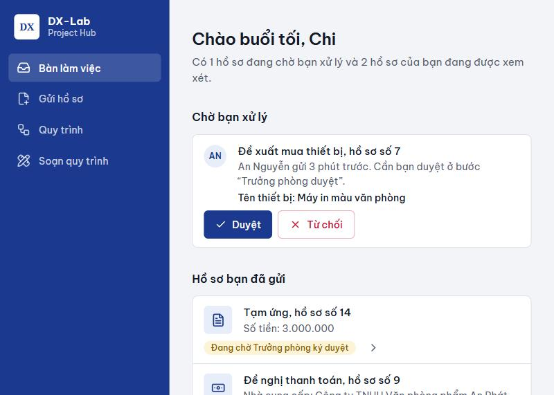
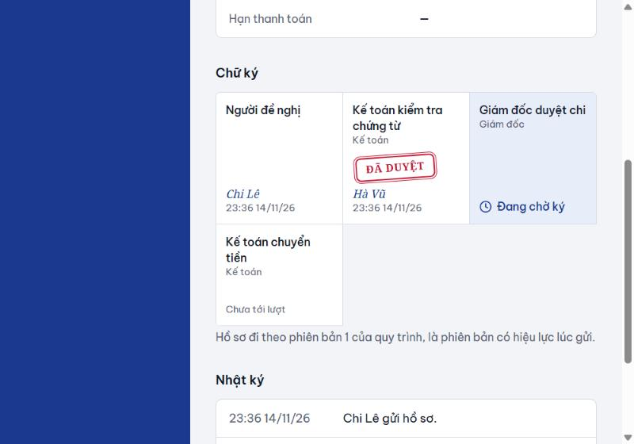
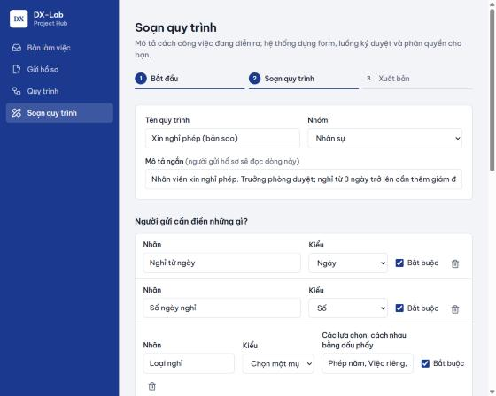
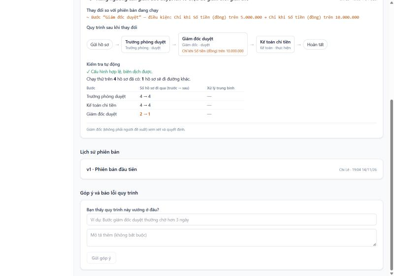
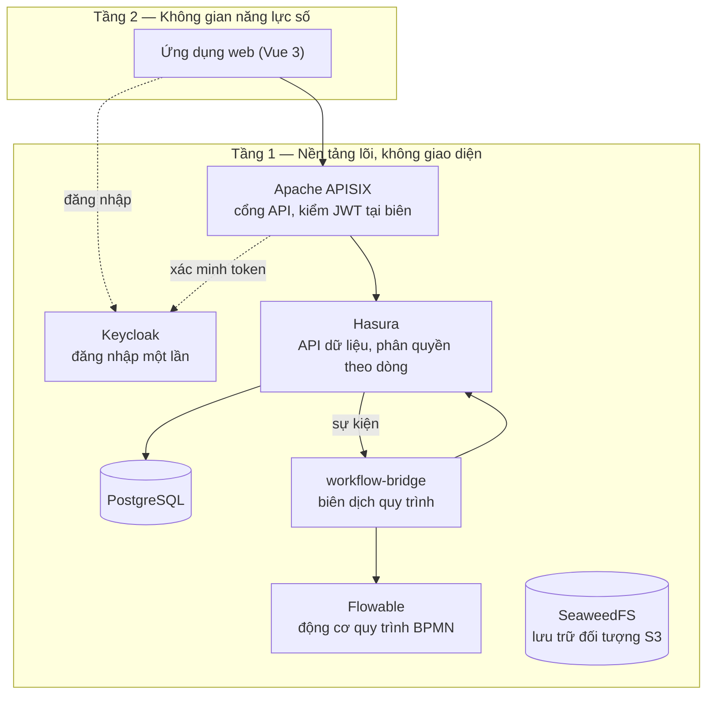

<!--
SPDX-FileCopyrightText: 2026 DX-Lab Project Hub contributors
SPDX-License-Identifier: Apache-2.0
-->

# DX-Lab Project Hub

[](https://github.com/ngophatneknha/OLP-MNM/actions/workflows/ci.yml)
[](https://github.com/ngophatneknha/OLP-MNM/releases)
[](LICENSE)

**Mô tả cách công việc đang diễn ra, nhận lại một ứng dụng chạy được — và quản lý quy trình của tổ chức như một dự án nguồn mở.**

Sản phẩm dự thi **OLP Phần mềm nguồn mở 2026**, chủ đề *Xây dựng Hệ điều hành Chuyển đổi số bằng công nghệ lõi nguồn mở (DX-OS Open-Core)*.



## Vấn đề

Doanh nghiệp nhỏ thường thất bại khi chuyển đổi số không phải vì thiếu phần mềm:

- Phần mềm có sẵn **không khớp cách họ đang làm việc**, nên vài tháng sau mọi người quay lại nhắn tin và bảng tính.
- Thuê viết riêng thì **quá đắt**, mà mỗi phòng ban lại có một quy trình khác nhau.
- Khi quy trình cần đổi, **không ai biết thay đổi đó ảnh hưởng tới việc đang chạy thế nào**, và không còn dấu vết ai đã đổi gì.

## Giải pháp

### 1. Nói ra quy trình, có ngay ứng dụng

Người quản lý viết một câu như *"Nhân viên xin tạm ứng, trưởng phòng duyệt, trên 5 triệu phải thêm giám đốc, kế toán chi tiền"*. Hệ thống làm phần còn lại:

1. **Trợ lý AI phác thảo** các ô thông tin và các bước xử lý, đồng thời hỏi lại những điểm còn mơ hồ.
2. **Con người xem lại** trên form và sơ đồ, sửa nếu cần. AI chỉ đề xuất, không tự xuất bản.
3. **Bấm xuất bản**: hệ thống tự sinh quy trình BPMN, form nhập liệu, phân quyền theo vai trò, kiểm tra dữ liệu đầu vào và bảng dữ liệu cho báo cáo.
4. **Nhân viên dùng ngay**: gửi hồ sơ, từng vai trò chỉ thấy và xử lý đúng bước của mình, sơ đồ cho biết hồ sơ đang ở đâu.

Không dùng AI vẫn làm được mọi thứ: tự khai báo trên form, hoặc lấy một quy trình trong [kho mẫu](library).





### 2. Quy trình là mã nguồn mở

Những gì cộng đồng nguồn mở dùng để quản lý mã, ở đây dùng để quản lý quy trình của tổ chức:

| Trong dự án nguồn mở | Trong DX-Lab Project Hub |
|---|---|
| Commit, bản phát hành, changelog | Mỗi lần phát hành quy trình là một **phiên bản** bất biến có ghi chú |
| Pull request | Muốn sửa quy trình đang chạy phải mở **đề xuất thay đổi** |
| CI kiểm tra pull request | Hệ thống tự kiểm tra và **chạy thử trên các hồ sơ đã có**: bao nhiêu hồ sơ sẽ đổi đường đi |
| Review bắt buộc | Người duyệt phải **khác người đề xuất** |
| Issue | Ai cũng **góp ý, báo lỗi** quy trình được, và ai cũng đọc được |
| Fork | Lấy quy trình từ **kho mẫu** về dùng, xuất tệp để đóng góp lại |



### 3. Trợ lý AI phải "thử việc"

Chuyển đổi số là chuyển dần quyền quyết định từ con người sang máy, nhưng không ai nên giao quyền cho máy theo cảm tính. Ở **mỗi bước duyệt**, trợ lý đi qua bốn nấc:

1. **Người làm**: trợ lý đứng ngoài.
2. **Chạy bóng**: trợ lý âm thầm cho ý kiến để so với quyết định thật của người; người duyệt chưa thấy ý kiến đó, nên không bị ảnh hưởng.
3. **Gợi ý**: người duyệt thấy ý kiến của trợ lý kèm lý do, vẫn là người bấm.
4. **Tự duyệt**: hồ sơ hợp lệ được duyệt luôn. Từ chối thì trợ lý **không bao giờ tự làm**; hồ sơ trở về cho người.

Lên nấc không phải do ai muốn: cơ sở dữ liệu chỉ cho giám đốc nâng, từng nấc một, và chỉ khi có ít nhất 10 quyết định thật của người ở nấc hiện tại với từ 90% khớp. Dữ liệu mẫu và các lần trợ lý tự duyệt không được tính làm bằng chứng. Hạ nấc thì trưởng phòng hay giám đốc làm được bất cứ lúc nào. Trợ lý học cách làm của tổ chức từ chính các quyết định gần đây ở bước đó.


Với mô hình nhỏ chạy thử, lần chạy bóng đầu đạt khoảng 7/12 khớp, chưa đủ để lên nấc; hệ thống làm đúng việc của nó là từ chối nâng quyền khi chưa có bằng chứng.

### 4. Điều hành bằng số liệu thật

Trưởng phòng và giám đốc có trang **Số liệu**: bao nhiêu hồ sơ đang chờ, mất bao lâu để xử lý xong, và **bước nào làm hồ sơ chờ lâu nhất**. Mọi con số tính từ chính hồ sơ và nhật ký ký duyệt bằng mã có kiểm thử, và dòng nào cũng bấm vào được hồ sơ gốc. Tệp đính kèm (báo giá, hóa đơn) lưu trong kho S3 và chỉ ai được xem hồ sơ mới tải được.


## Kiến trúc

Hệ thống theo đúng mô hình DX-OS: tầng lõi chạy ngầm không có giao diện, tầng ứng dụng chỉ nói chuyện với lõi qua cổng API.



| Yêu cầu của đề | Thành phần | Giấy phép |
|---|---|---|
| Định danh, đăng nhập một lần | Keycloak | Apache-2.0 |
| Cổng API | Apache APISIX | Apache-2.0 |
| Dữ liệu có cấu trúc | PostgreSQL + Hasura | PostgreSQL / Apache-2.0 |
| Dữ liệu phi cấu trúc | SeaweedFS | Apache-2.0 |
| Động cơ luồng công việc | Flowable | Apache-2.0 |

Mã do dự án tự viết gồm `services/workflow-bridge` (bộ biên dịch quy trình và cầu nối sự kiện, không phụ thuộc gói ngoài) và `web/` (ứng dụng web). Chi tiết thiết kế: [docs/architecture.md](docs/architecture.md).

## Cài đặt từ mã nguồn

**Yêu cầu:** Docker và Docker Compose v2, khoảng 4 GB RAM dành cho Docker. Không cần cài gì khác.

```bash
git clone https://github.com/ngophatneknha/OLP-MNM.git
cd OLP-MNM
cp .env.example .env
docker compose up -d --build
```

Hoặc tải tệp `.tar.gz` của [bản phát hành mới nhất](https://github.com/ngophatneknha/OLP-MNM/releases), giải nén rồi chạy hai lệnh cuối.

Lần khởi động đầu mất khoảng 1–2 phút. Sau đó nạp dữ liệu mẫu (4 quy trình và 9 hồ sơ ở nhiều trạng thái):

```bash
docker compose exec workflow-bridge node seed.js
```

Có trợ lý AI cấu hình thì có thể cho nó chạy bóng thật trên 12 hồ sơ để xem độ khớp: `docker compose exec workflow-bridge node seed.js --ai-demo`.

Mở **http://localhost:3000** và đăng nhập.

### Tài khoản mẫu

| Tài khoản | Vai trò | Làm được gì |
|---|---|---|
| `staff1`, `staff2` | Nhân viên | Gửi hồ sơ kèm tệp, theo dõi hồ sơ của mình, góp ý quy trình |
| `manager1` | Trưởng phòng | Duyệt hồ sơ, xem số liệu, soạn quy trình, mở đề xuất thay đổi |
| `director1` | Giám đốc | Duyệt hồ sơ, xem số liệu, chấp nhận hoặc từ chối đề xuất thay đổi |
| `accountant1` | Kế toán | Xử lý các bước chi tiền, đặt hàng, kiểm tra chứng từ |

Mật khẩu dùng chung cho các tài khoản mẫu nằm trong [`infra/keycloak/realm/dxlab-realm.json`](infra/keycloak/realm/dxlab-realm.json). Chúng chỉ dành cho chạy thử; đổi trước khi dùng thật.

### Thử trong 3 phút

1. Đăng nhập `staff1`, vào **Gửi hồ sơ**, chọn một loại hồ sơ, điền và gửi.
2. Đăng nhập `manager1` (lần đầu phải thiết lập OTP bằng ứng dụng trên điện thoại), mở **Bàn làm việc** và duyệt hồ sơ; xem thêm **Bảng công việc** và **Lịch**.
3. Vẫn là `manager1`: vào **Soạn quy trình** để lấy một quy trình trong kho mẫu hoặc gõ mô tả bằng lời rồi **Xuất bản**; mở một quy trình, đổi một điều kiện và **Gửi đề xuất thay đổi**.
4. Đăng nhập `director1` (cũng cần OTP), vào **Quy trình** để xem phần khác biệt, kết quả chạy thử trên hồ sơ cũ, rồi chấp nhận; vào **Số liệu** và **Trợ lý AI**.

Hướng dẫn đầy đủ từng màn hình: [docs/HUONG_DAN.md](docs/HUONG_DAN.md). Kịch bản trình diễn 15 phút: [docs/KICH_BAN_DEMO.md](docs/KICH_BAN_DEMO.md), kèm [slide thuyết trình](docs/slides/index.html) (mở bằng trình duyệt).

### Các địa chỉ

| Dịch vụ | Địa chỉ | Ghi chú |
|---|---|---|
| Ứng dụng web | http://localhost:3000 | |
| Cổng API | http://localhost:9080 | Cổng vào duy nhất tới dữ liệu, quy trình và tệp |
| Keycloak | http://localhost:8081 | Trang đăng nhập; tài khoản quản trị trong `.env` |

Chỉ ba cổng trên được mở ra máy chủ. PostgreSQL, Hasura, Flowable, kho S3 và `workflow-bridge` chỉ nằm trong mạng nội bộ của Docker; mọi truy cập đều đi qua cổng API, nơi token được kiểm tra trước.
Sao lưu, khôi phục, TLS (Caddy), tường lửa (Coraza), két bí mật (OpenBao), giám sát (Prometheus) và xác thực nhiều yếu tố: xem [docs/VAN_HANH.md](docs/VAN_HANH.md). Hỏi đáp tài liệu có kiểm quyền và AI chạy tại chỗ: [docs/TRI_TUE.md](docs/TRI_TUE.md).

Dừng hệ thống: `docker compose down`. Dừng và xóa toàn bộ dữ liệu: `docker compose down -v`.

## Cấu hình

Mọi cấu hình nằm trong tệp `.env` (mẫu: [`.env.example`](.env.example)); không phải sửa mã nguồn.

### Trợ lý AI (tùy chọn)

Đặt `AI_BASE_URL`, `AI_MODEL`, `AI_API_KEY` rồi chạy lại `docker compose up -d`. Hệ thống gọi được mọi máy chủ tương thích OpenAI `/chat/completions`.

- **Giữ dữ liệu trong nội bộ:** trỏ tới [Ollama](https://ollama.com) hoặc vLLM chạy trên máy của bạn với một mô hình trọng số mở.
- **Dùng dịch vụ ngoài:** nội dung mô tả quy trình sẽ được gửi tới dịch vụ đó.
- **Để trống:** tính năng AI tắt, mọi phần khác hoạt động bình thường.

## Gói container (GitHub Packages)

Mỗi bản phát hành còn có hai image dựng sẵn trên [GitHub Packages](https://github.com/ngophatneknha/OLP-MNM/pkgs/container/dxlab-web), chỉ chứa mã của chính dự án (cùng giấy phép Apache-2.0):

```bash
docker pull ghcr.io/ngophatneknha/dxlab-web:latest              # ứng dụng web (nginx + bản dựng Vue)
docker pull ghcr.io/ngophatneknha/dxlab-workflow-bridge:latest  # bộ biên dịch quy trình và cầu nối Hasura–Flowable
```

Hai image này chỉ là tiện lợi. Cách cài chuẩn vẫn là dựng từ mã nguồn bằng `docker compose up -d --build`, nên không phụ thuộc gói nào. `workflow-bridge` cần gắn thư mục `library/` vào `/library`.

## Kiểm thử

Kiểm thử đối chiếu trực tiếp với tài liệu của Ban tổ chức (đề thi và thể lệ), chạy trên hệ thống thật, không giả lập:

```bash
docker compose up -d --build && node tests/wait-ready.js   # dựng hệ thống và chờ sẵn sàng (cần Node.js 22)
node --test --test-reporter=spec tests/*.test.js          # toàn bộ kiểm thử đối chiếu (khoảng 4 phút)
node --test services/workflow-bridge/*.test.js web/src/metrics.test.js web/src/i18n.test.js web/src/snippet.test.js   # kiểm thử đơn vị (không cần hệ thống chạy)
```

| Tệp | Đối chiếu với | Nội dung |
|---|---|---|
| `tests/tang1.test.js` | Đề thi mục 3-4: Tầng 1 | SSO/OIDC, cổng API (giả mạo token, CORS, giới hạn tần suất), headless, dữ liệu cấu trúc, kho tệp, kiểm dịch mã độc, luồng BPMN, tải đồng thời |
| `tests/hpdi.test.js` | Đề thi mục 3: ứng dụng H-P-D-I | Bộ sinh quy trình (kể cả tiêm mã), đề xuất thay đổi, số liệu đối chiếu SQL, AI thật, nấc tự chủ |
| `tests/ops.test.js`, `tests/restore.test.js` | Vận hành | Script sao lưu, TLS, giám sát (cần bật thành phần tùy chọn), vòng sao lưu rồi khôi phục thảm họa (`RESTORE_TEST=1`) |
| `tests/search.test.js` | Đề thi [I] | Tìm kiếm toàn văn và hỏi đáp có dẫn nguồn, kiểm quyền từng kết quả (cần bật profile `search`) |
| `tests/pof.test.js` | Thể lệ: 6 tiêu chí PoF | Kho công khai, giấy phép từng tệp, bản phát hành `.tar.gz`, dựng từ bản phát hành, thư viện đính kèm, tài liệu, bug tracker |

Kết quả và các điểm chưa làm: [docs/KIEM_THU.md](docs/KIEM_THU.md). Các điểm chưa làm khai báo bằng `todo` nên báo cáo không tô hồng. CI chạy toàn bộ trên mỗi pull request.

## Cấu trúc kho mã

```
docker-compose.yml          toàn bộ hệ thống
infra/                      cấu hình Keycloak, APISIX, Hasura, PostgreSQL
services/workflow-bridge/   bộ biên dịch quy trình, cầu nối Hasura–Flowable, trợ lý AI
web/                        ứng dụng web (Vue 3)
library/                    kho quy trình mẫu, mỗi quy trình một tệp JSON
tests/                      kiểm thử đối chiếu đề thi và thể lệ
scripts/                    công cụ theo dõi tiến độ
docs/                       kiến trúc và kế hoạch
```

## Hiện trạng và hướng phát triển

**Đã chạy được, có kiểm thử trên hệ thống thật:** nền tảng lõi Tầng 1 (SSO có MFA, cổng API, dữ liệu cấu trúc và phi cấu trúc, luồng BPMN), bộ sinh ứng dụng từ mô tả, trợ lý AI phác thảo, phiên bản và đề xuất thay đổi quy trình, tệp đính kèm có quét mã độc, bảng công việc, lịch, thông báo, số liệu điều hành, hỏi đáp tài liệu có dẫn nguồn và kiểm quyền, trợ lý AI thử việc bốn nấc, sao lưu và khôi phục, TLS và giám sát tùy chọn, giao diện vi/en.

**Chưa làm, nói thẳng** (khai báo là `todo` trong báo cáo kiểm thử): tìm kiếm véc-tơ ngữ nghĩa và đọc PDF/OCR; kho dữ liệu lạnh, NGSI-LD, WebGIS; két bí mật; WAF; ẩn thông tin định danh; sao lưu tự động theo lịch; dịch nốt các trang cũ sang tiếng Anh; wiki và điểm trưởng thành H-P-D-I.

### Muốn đóng góp?

Các việc nhỏ, rõ ràng, phù hợp người mới được gắn nhãn [`good first issue`](https://github.com/ngophatneknha/OLP-MNM/issues?q=is%3Aissue+is%3Aopen+label%3A%22good+first+issue%22): đóng góp một quy trình mẫu vào `library/`, dịch một trang sang tiếng Anh, thêm quy tắc cảnh báo cho Prometheus, viết thêm ca kiểm thử. Cách làm từng bước: [CONTRIBUTING.md](CONTRIBUTING.md). Mọi đóng góp đều phải qua pull request và CI.

Danh sách đầu việc và tiến độ: [docs/BACKLOG.md](docs/BACKLOG.md). Lịch sử thay đổi: [CHANGELOG.md](CHANGELOG.md). Tài liệu: [người dùng](docs/HUONG_DAN.md), [kỹ thuật và vận hành](docs/KY_THUAT.md), [kiến trúc](docs/architecture.md).

## Đóng góp

Báo lỗi và đề xuất tại mục [Issues](https://github.com/ngophatneknha/OLP-MNM/issues). Cách đóng góp mã, và cách **đóng góp một quy trình vào kho mẫu**: [CONTRIBUTING.md](CONTRIBUTING.md).

## Giấy phép

Mã nguồn của dự án phát hành theo [Apache License 2.0](LICENSE). Mỗi tệp mã mang tiêu đề SPDX và được kiểm tra bằng [REUSE](https://reuse.software) trong CI. Các thành phần bên thứ ba chạy dưới dạng container riêng, không sửa và không đính kèm mã vào kho này; danh sách và giấy phép: [THIRD_PARTY.md](THIRD_PARTY.md).
