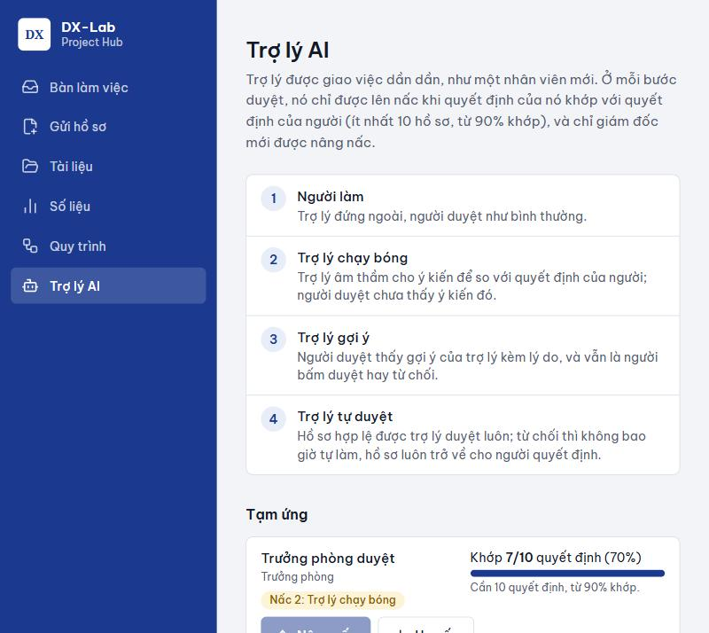
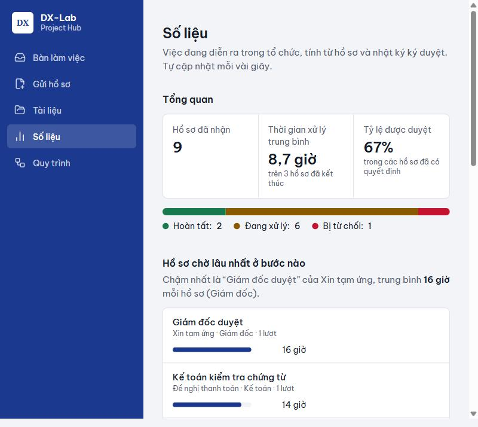
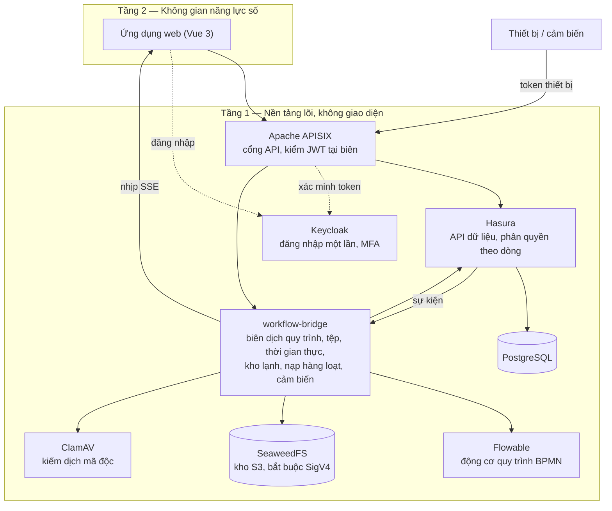

<!--
SPDX-FileCopyrightText: 2026 DX-Lab Project Hub contributors
SPDX-License-Identifier: Apache-2.0
-->

# DX-Lab Project Hub

[](https://github.com/ngophatneknha/OLP-MNM/actions/workflows/ci.yml)
[](https://github.com/ngophatneknha/OLP-MNM/releases)
[](LICENSE)
[](https://reuse.software)

**Mô tả cách công việc đang diễn ra, nhận lại một ứng dụng chạy được. Quy trình của tổ chức được quản lý như mã nguồn mở: có phiên bản, đề xuất thay đổi, người duyệt và nhật ký bất biến.**

> *English:* an open-core "Digital Transformation OS" (DX-OS). Describe a business process in plain words; an AI assistant drafts it, a human reviews it, and one click publishes a working BPMN workflow with forms, role-based access, audit trail and reports. Processes are versioned and changed through pull-request-style proposals. Everything runs from one `docker compose up` on Apache-2.0 / OSI-licensed components (Keycloak, APISIX, PostgreSQL + Hasura, Flowable, SeaweedFS, ClamAV). Entry for the Vietnam Open Source Software Olympiad (OLP) 2026.


## Cài đặt và chạy thử trong 5 phút

**Yêu cầu:** Docker và Docker Compose v2, khoảng 4 GB RAM dành cho Docker (bản lõi đo thực tế khoảng 3 GiB).

```bash
git clone https://github.com/ngophatneknha/OLP-MNM.git
cd OLP-MNM
cp .env.example .env
docker compose up -d --build
docker compose exec workflow-bridge node seed.js    # nạp dữ liệu mẫu (sau khi các dịch vụ đã lên)
```

Lần đầu mất 1–2 phút (ClamAV tải thêm cơ sở dữ liệu nhận dạng vài phút nữa). Mở **http://localhost:3000**, đăng nhập `staff1` (nhân viên), gửi một hồ sơ; rồi đăng nhập `manager1` để duyệt. Mật khẩu tài khoản mẫu nằm trong [`infra/keycloak/realm/dxlab-realm.json`](infra/keycloak/realm/dxlab-realm.json), chỉ dùng để chạy thử; **đổi hết các giá trị `change-me` trong `.env` và mật khẩu mẫu trước khi đưa lên Internet**.

Không muốn dựng từ mã nguồn: tải `.tar.gz` ở [bản phát hành](https://github.com/ngophatneknha/OLP-MNM/releases), giải nén, chạy bốn lệnh cuối.

| Tài khoản | Vai trò | Ghi chú |
|---|---|---|
| `staff1`, `staff2` | Nhân viên | gửi hồ sơ, góp ý quy trình |
| `staffb1`, `managerb1`, `directorb1` | Tổ chức B | cùng vai trò, thuộc tổ chức khác, để thử cách ly dữ liệu |
| `manager1` | Trưởng phòng | duyệt, soạn quy trình, đề xuất thay đổi; bắt buộc OTP |
| `director1` | Giám đốc | chấp nhận đề xuất, nâng nấc trợ lý, kho lạnh, cảm biến; bắt buộc OTP |
| `accountant1` | Kế toán | các bước chi tiền, chứng từ |

| Dịch vụ | Địa chỉ |
|---|---|
| Ứng dụng web | http://localhost:3000 |
| Cổng API (lối vào duy nhất tới dữ liệu) | http://localhost:9080 |
| Keycloak | http://localhost:8081 |

Các dịch vụ còn lại chỉ nằm trong mạng nội bộ của Docker. Dừng: `docker compose down` (thêm `-v` để xóa dữ liệu). Dựng lại sạch trước mỗi lần diễn tập: `sh scripts/demo-reset.sh`.

Hướng dẫn từng màn hình: [docs/HUONG_DAN.md](docs/HUONG_DAN.md). Kịch bản trình diễn 15 phút: [docs/KICH_BAN_DEMO.md](docs/KICH_BAN_DEMO.md), kèm [slide](docs/slides/index.html). Xem nền tảng Tầng 1 chạy trong hai phút (cảm biến, kho lạnh, phả hệ, đa tổ chức, cổng API): `node scripts/demo-platform.mjs`.

## Vấn đề và cách giải

Doanh nghiệp nhỏ thất bại khi chuyển đổi số vì phần mềm có sẵn không khớp cách họ làm việc, thuê viết riêng thì đắt, và khi quy trình đổi thì không ai biết ảnh hưởng ra sao, ai đã đổi gì. DX-Lab Project Hub giải quyết bằng bốn việc:

**1. Nói ra quy trình, có ngay ứng dụng.** Người quản lý viết *"nhân viên xin tạm ứng, trưởng phòng duyệt, trên 5 triệu phải thêm giám đốc, kế toán chi tiền"*. Trợ lý AI phác thảo ô thông tin và các bước; con người xem lại và sửa; bấm xuất bản thì hệ thống sinh quy trình BPMN, form, phân quyền theo vai trò và bảng cho báo cáo. Màn hình tự cập nhật khi có người ký (SSE). Không có AI vẫn dùng được: tự khai báo trên form hoặc lấy mẫu trong [library/](library).


**2. Quy trình là mã nguồn mở.**

| Trong dự án nguồn mở | Trong DX-Lab Project Hub |
|---|---|
| Commit, bản phát hành | Mỗi lần phát hành quy trình là một **phiên bản** bất biến có ghi chú |
| Pull request + CI | **Đề xuất thay đổi**; hệ thống tự **chạy thử trên các hồ sơ đã có** (bao nhiêu hồ sơ đổi đường đi) |
| Review bắt buộc | Người duyệt phải **khác người đề xuất** |
| Issue, Fork | Ai cũng góp ý được; lấy quy trình từ **kho mẫu** về dùng |


**3. Trợ lý AI phải "thử việc".** Ở mỗi bước duyệt có bốn nấc: *người làm* → *chạy bóng* (trợ lý cho ý kiến ngầm để so với quyết định thật) → *gợi ý* → *tự duyệt* (không bao giờ tự từ chối). Chỉ giám đốc nâng được, từng nấc một, và chỉ khi có ít nhất 10 quyết định thật của người với từ 90% khớp; điều kiện này do cơ sở dữ liệu ép chứ không chỉ do giao diện. Thông tin cá nhân (email, số điện thoại, CCCD, số thẻ) bị thay bằng nhãn trước khi rời hệ thống tới máy chủ AI.



**4. Điều hành bằng số liệu thật.** Trang Số liệu cho biết hồ sơ đang chờ, thời gian xử lý, bước làm hồ sơ chờ lâu nhất và điểm trưởng thành H-P-D-I (0–100, công thức công bố); mọi con số bấm được tới hồ sơ gốc.



Ngoài ra: **nhiều tổ chức dùng chung một hệ thống** mà không thấy dữ liệu của nhau (cách ly bằng `org_id` trong token, Hasura và CSDL), **kho lạnh bất biến** (hồ sơ đã kết thúc xuất ra JSONL trong kho S3, ghi vào sổ cái băm nối chuỗi mà cơ sở dữ liệu không cho sửa; `/archive/verify` phát hiện giả mạo), **phả hệ dữ liệu** tự lấy từ danh mục PostgreSQL, **nạp hàng loạt** CSV/JSON và **cảm biến IT/OT** (vượt ngưỡng thì tự mở hồ sơ sửa chữa đi qua quy trình duyệt của người). Tệp đính kèm lưu trong kho S3 có xác thực SigV4, quét mã độc trước khi nhận.

## Kiến trúc

Tầng lõi chạy ngầm không giao diện; ứng dụng web chỉ nói chuyện với lõi qua cổng API.



| Thành phần | Giấy phép |
|---|---|
| Keycloak (đăng nhập một lần) | Apache-2.0 |
| Apache APISIX (cổng API) | Apache-2.0 |
| PostgreSQL + Hasura (dữ liệu có cấu trúc) | PostgreSQL / Apache-2.0 |
| SeaweedFS (dữ liệu phi cấu trúc) | Apache-2.0 |
| Flowable (luồng công việc) | Apache-2.0 |
| ClamAV (chạy riêng, không sửa) | GPL-2.0 |

Mã do dự án tự viết: `services/workflow-bridge` (không phụ thuộc gói ngoài) và `web/`. Thiết kế chi tiết: [docs/architecture.md](docs/architecture.md); danh sách điểm vào của cổng API: [docs/KY_THUAT.md](docs/KY_THUAT.md#các-điểm-vào-của-cổng-api).

## Cấu hình

Mọi cấu hình nằm trong `.env` ([mẫu](.env.example)), không phải sửa mã.

**Trợ lý AI (tùy chọn):** đặt `AI_BASE_URL`, `AI_MODEL`, `AI_API_KEY` (mọi máy chủ tương thích OpenAI `/chat/completions`), rồi `docker compose up -d`. Trỏ tới [Ollama](https://ollama.com) hoặc vLLM trên máy bạn thì dữ liệu không rời nội bộ; dùng dịch vụ ngoài thì nội dung mô tả được gửi đi (đã che thông tin cá nhân); để trống thì tính năng AI tắt, phần còn lại vẫn chạy.

**Thành phần tùy chọn** (`docker-compose.optional.yml`, tách khỏi bản lõi để máy yếu vẫn chạy):

```bash
docker compose -f docker-compose.yml -f docker-compose.optional.yml --profile tls --profile waf up -d --build
```

| Profile | Thành phần | Dùng để |
|---|---|---|
| `tls` | Caddy | HTTPS tại biên |
| `waf` | Coraza + OWASP CRS | tường lửa ứng dụng (cổng 9081) |
| `vault` | OpenBao | két bí mật, chuyển bí mật khỏi `.env` (`scripts/vault.sh`) |
| `monitoring` | Prometheus | số đo của cổng API |
| `search` | Meilisearch | tìm kiếm toàn văn, hỏi đáp có dẫn nguồn và kiểm quyền |
| `ai` | Ollama | mô hình ngôn ngữ chạy tại chỗ |

Hướng dẫn: [VAN_HANH.md](docs/VAN_HANH.md) (TLS, WAF, két, sao lưu tự động và khôi phục, GitOps nhẹ, MFA, giám sát), [TRI_TUE.md](docs/TRI_TUE.md) (tìm kiếm, AI).

**Image dựng sẵn** (chỉ là tiện lợi, cách cài chuẩn vẫn là dựng từ mã nguồn): `ghcr.io/ngophatneknha/dxlab-web` và `ghcr.io/ngophatneknha/dxlab-workflow-bridge` (mount `library/` vào `/library`).

## Kiểm thử

Kiểm thử đối chiếu từng điều khoản của đề thi và thể lệ, chạy trên hệ thống thật, không giả lập. CI chạy toàn bộ trên mỗi pull request.

```bash
docker compose up -d --build && node tests/wait-ready.js   # cần Node.js 22
node --test --test-reporter=spec tests/*.test.js           # đối chiếu đề thi, vài phút
(cd web && npm ci) && node --test services/workflow-bridge/*.test.js web/src/*.test.js   # đơn vị, không cần hệ thống chạy
```

Các nhóm: Tầng 1 (`tang1`), ứng dụng H-P-D-I và Zero-Trust (`hpdi`), kho lạnh (`cold`), cảm biến (`iot`), đa tổ chức và nâng cấp (`tenant`, `upgrade`), chữ ký số (`pki`), vận hành và khôi phục (`ops`, `recovery`, `restore`), tìm kiếm (`search`), tiêu chí PoF và điều khoản ngoài bảng điểm (`pof`, `luat`). Bảng đối chiếu từng ca và kết quả: [docs/KIEM_THU.md](docs/KIEM_THU.md).

## Còn thiếu gì (nói thẳng)

Các mục dưới đây khai báo là `todo` trong báo cáo kiểm thử, không tô hồng:

- Kho lạnh là tệp JSONL (truy vấn được bằng SQL qua DuckDB), chưa phải bảng lakehouse Parquet/Iceberg; NGSI-LD chỉ đọc; bản đồ cảm biến là SVG tối giản, chưa có nền bản đồ.
- Tìm ngữ nghĩa là tùy chọn (mặc định tắt, mô hình nhỏ); OCR chỉ 10 trang đầu; chưa có cơ sở dữ liệu véc-tơ riêng (Qdrant).
- Chữ ký số là PKI phần mềm (chứng thư X.509 do CA của từng tổ chức cấp, ký phía máy chủ, khóa mã hóa trong CSDL): **chưa có HSM, CRL/OCSP** và chưa phải chữ ký số có giá trị pháp lý theo luật.
- Thời gian thực dùng SSE (chưa WebSocket); thiết bị gọi HTTP (chưa MQTT/OPC UA).
- Sao lưu tự động chỉ gồm CSDL (kho tệp dùng script); két bí mật mới có một khóa mở; GitOps chỉ ở mức một máy, chưa phải ArgoCD/Flux.
- Đa tổ chức đã cách ly ở CSDL, có quản trị người dùng theo tổ chức và vai trò BI riêng; còn thiếu: mã ứng dụng (`app.key`) vẫn duy nhất toàn hệ thống, bước Keycloak của nâng cấp từ bản cũ làm tay.

## Đóng góp

Báo lỗi, đề xuất: [Issues](https://github.com/ngophatneknha/OLP-MNM/issues). Việc nhỏ hợp người mới có nhãn [`good first issue`](https://github.com/ngophatneknha/OLP-MNM/issues?q=is%3Aissue+is%3Aopen+label%3A%22good+first+issue%22): đóng góp quy trình mẫu vào `library/`, thêm quy tắc cảnh báo, viết thêm ca kiểm thử. Cách làm từng bước: [CONTRIBUTING.md](CONTRIBUTING.md). Mọi đóng góp đi qua pull request và CI.

Tài liệu: [người dùng](docs/HUONG_DAN.md) · [kỹ thuật](docs/KY_THUAT.md) · [vận hành](docs/VAN_HANH.md) · [kiến trúc](docs/architecture.md) · [kiểm thử](docs/KIEM_THU.md) · [AI và tìm kiếm](docs/TRI_TUE.md) · [đầu việc](docs/BACKLOG.md) · [lịch sử thay đổi](CHANGELOG.md).

## Giấy phép

Mã nguồn dự án theo [Apache License 2.0](LICENSE); mỗi tệp có tiêu đề SPDX và được [REUSE](https://reuse.software) kiểm tra trong CI. Thành phần bên thứ ba chạy như container riêng, không sửa và không đính kèm mã vào kho này: xem [THIRD_PARTY.md](THIRD_PARTY.md).
