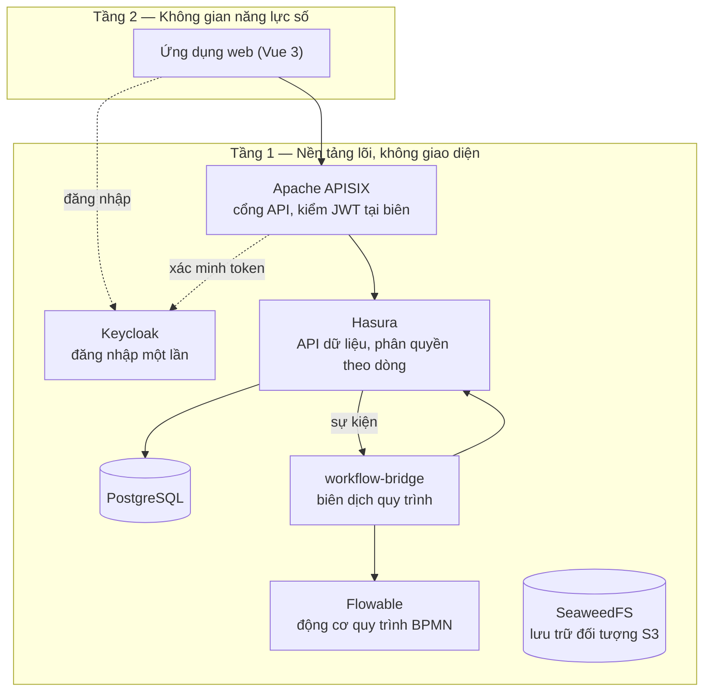

<!--
SPDX-FileCopyrightText: 2026 DX-Lab Project Hub contributors
SPDX-License-Identifier: Apache-2.0
-->

# DX-Lab Project Hub

[](https://github.com/ngophatneknha/OLP-MNM/actions/workflows/ci.yml)
[](https://github.com/ngophatneknha/OLP-MNM/releases)
[](LICENSE)

**Mô tả cách công việc đang diễn ra, nhận lại một ứng dụng chạy được — và quản lý quy trình của tổ chức như một dự án nguồn mở.**

Sản phẩm dự thi **OLP Phần mềm nguồn mở 2026**, chủ đề *Xây dựng Hệ điều hành Chuyển đổi số bằng công nghệ lõi nguồn mở (DX-OS Open-Core)*.


## Vấn đề

Doanh nghiệp nhỏ thường thất bại khi chuyển đổi số không phải vì thiếu phần mềm:

- Phần mềm có sẵn **không khớp cách họ đang làm việc**, nên vài tháng sau mọi người quay lại nhắn tin và bảng tính.
- Thuê viết riêng thì **quá đắt**, mà mỗi phòng ban lại có một quy trình khác nhau.
- Khi quy trình cần đổi, **không ai biết thay đổi đó ảnh hưởng tới việc đang chạy thế nào**, và không còn dấu vết ai đã đổi gì.

## Giải pháp

### 1. Nói ra quy trình, có ngay ứng dụng

Người quản lý viết một câu như *"Nhân viên xin tạm ứng, trưởng phòng duyệt, trên 5 triệu phải thêm giám đốc, kế toán chi tiền"*. Hệ thống làm phần còn lại:

1. **Trợ lý AI phác thảo** các ô thông tin và các bước xử lý, đồng thời hỏi lại những điểm còn mơ hồ.
2. **Con người xem lại** trên form và sơ đồ, sửa nếu cần. AI chỉ đề xuất, không tự xuất bản.
3. **Bấm xuất bản**: hệ thống tự sinh quy trình BPMN, form nhập liệu, phân quyền theo vai trò, kiểm tra dữ liệu đầu vào và bảng dữ liệu cho báo cáo.
4. **Nhân viên dùng ngay**: gửi hồ sơ, từng vai trò chỉ thấy và xử lý đúng bước của mình, sơ đồ cho biết hồ sơ đang ở đâu.

Không dùng AI vẫn làm được mọi thứ: tự khai báo trên form, hoặc lấy một quy trình trong [kho mẫu](library).


### 2. Quy trình là mã nguồn mở

Những gì cộng đồng nguồn mở dùng để quản lý mã, ở đây dùng để quản lý quy trình của tổ chức:

| Trong dự án nguồn mở | Trong DX-Lab Project Hub |
|---|---|
| Commit, bản phát hành, changelog | Mỗi lần phát hành quy trình là một **phiên bản** bất biến có ghi chú |
| Pull request | Muốn sửa quy trình đang chạy phải mở **đề xuất thay đổi** |
| CI kiểm tra pull request | Hệ thống tự kiểm tra và **chạy thử trên các hồ sơ đã có**: bao nhiêu hồ sơ sẽ đổi đường đi |
| Review bắt buộc | Người duyệt phải **khác người đề xuất** |
| Issue | Ai cũng **góp ý, báo lỗi** quy trình được, và ai cũng đọc được |
| Fork | Lấy quy trình từ **kho mẫu** về dùng, xuất tệp để đóng góp lại |


### 3. Điều hành bằng số liệu thật

Trưởng phòng và giám đốc có trang **Số liệu**: bao nhiêu hồ sơ đang chờ, mất bao lâu để xử lý xong, và **bước nào làm hồ sơ chờ lâu nhất**. Mọi con số tính từ chính hồ sơ và nhật ký ký duyệt bằng mã có kiểm thử, và dòng nào cũng bấm vào được hồ sơ gốc. Tệp đính kèm (báo giá, hóa đơn) lưu trong kho S3 và chỉ ai được xem hồ sơ mới tải được.


## Kiến trúc

Hệ thống theo đúng mô hình DX-OS: tầng lõi chạy ngầm không có giao diện, tầng ứng dụng chỉ nói chuyện với lõi qua cổng API.



| Yêu cầu của đề | Thành phần | Giấy phép |
|---|---|---|
| Định danh, đăng nhập một lần | Keycloak | Apache-2.0 |
| Cổng API | Apache APISIX | Apache-2.0 |
| Dữ liệu có cấu trúc | PostgreSQL + Hasura | PostgreSQL / Apache-2.0 |
| Dữ liệu phi cấu trúc | SeaweedFS | Apache-2.0 |
| Động cơ luồng công việc | Flowable | Apache-2.0 |

Mã do dự án tự viết gồm `services/workflow-bridge` (bộ biên dịch quy trình và cầu nối sự kiện, không phụ thuộc gói ngoài) và `web/` (ứng dụng web). Chi tiết thiết kế: [docs/architecture.md](docs/architecture.md).

## Cài đặt từ mã nguồn

**Yêu cầu:** Docker và Docker Compose v2, khoảng 4 GB RAM dành cho Docker. Không cần cài gì khác.

```bash
git clone https://github.com/ngophatneknha/OLP-MNM.git
cd OLP-MNM
cp .env.example .env
docker compose up -d --build
```

Hoặc tải tệp `.tar.gz` của [bản phát hành mới nhất](https://github.com/ngophatneknha/OLP-MNM/releases), giải nén rồi chạy hai lệnh cuối.

Lần khởi động đầu mất khoảng 1–2 phút. Sau đó nạp dữ liệu mẫu (4 quy trình và 9 hồ sơ ở nhiều trạng thái):

```bash
docker compose exec workflow-bridge node seed.js
```

Mở **http://localhost:3000** và đăng nhập.

### Tài khoản mẫu

| Tài khoản | Vai trò | Làm được gì |
|---|---|---|
| `staff1`, `staff2` | Nhân viên | Gửi hồ sơ kèm tệp, theo dõi hồ sơ của mình, góp ý quy trình |
| `manager1` | Trưởng phòng | Duyệt hồ sơ, xem số liệu, soạn quy trình, mở đề xuất thay đổi |
| `director1` | Giám đốc | Duyệt hồ sơ, xem số liệu, chấp nhận hoặc từ chối đề xuất thay đổi |
| `accountant1` | Kế toán | Xử lý các bước chi tiền, đặt hàng, kiểm tra chứng từ |

Mật khẩu dùng chung cho các tài khoản mẫu nằm trong [`infra/keycloak/realm/dxlab-realm.json`](infra/keycloak/realm/dxlab-realm.json). Chúng chỉ dành cho chạy thử; đổi trước khi dùng thật.

### Thử trong 3 phút

1. Đăng nhập `manager1`, vào **Tạo ứng dụng**, chọn một quy trình trong kho mẫu hoặc gõ mô tả rồi bấm **Xuất bản**.
2. Đăng nhập `staff1`, vào **Ứng dụng**, điền form và gửi.
3. Đăng nhập lại `manager1`, vào **Việc của tôi** để duyệt.
4. Vẫn là `manager1`: mở lại quy trình vừa tạo, đổi một điều kiện và **Gửi đề xuất thay đổi**.
5. Đăng nhập `director1`, vào **Quy trình** để xem phần khác biệt, kết quả chạy thử, rồi chấp nhận.

### Các địa chỉ

| Dịch vụ | Địa chỉ | Ghi chú |
|---|---|---|
| Ứng dụng web | http://localhost:3000 | |
| Cổng API | http://localhost:9080 | Cổng vào duy nhất tới dữ liệu, quy trình và tệp |
| Keycloak | http://localhost:8081 | Trang đăng nhập; tài khoản quản trị trong `.env` |

Chỉ ba cổng trên được mở ra máy chủ. PostgreSQL, Hasura, Flowable, kho S3 và `workflow-bridge` chỉ nằm trong mạng nội bộ của Docker; mọi truy cập đều đi qua cổng API, nơi token được kiểm tra trước.
Dừng hệ thống: `docker compose down`. Dừng và xóa toàn bộ dữ liệu: `docker compose down -v`.

## Cấu hình

Mọi cấu hình nằm trong tệp `.env` (mẫu: [`.env.example`](.env.example)); không phải sửa mã nguồn.

### Trợ lý AI (tùy chọn)

Đặt `AI_BASE_URL`, `AI_MODEL`, `AI_API_KEY` rồi chạy lại `docker compose up -d`. Hệ thống gọi được mọi máy chủ tương thích OpenAI `/chat/completions`.

- **Giữ dữ liệu trong nội bộ:** trỏ tới [Ollama](https://ollama.com) hoặc vLLM chạy trên máy của bạn với một mô hình trọng số mở.
- **Dùng dịch vụ ngoài:** nội dung mô tả quy trình sẽ được gửi tới dịch vụ đó.
- **Để trống:** tính năng AI tắt, mọi phần khác hoạt động bình thường.

## Kiểm thử

```bash
node --test services/workflow-bridge/compile.test.js   # bộ biên dịch quy trình (cần Node.js 22)
sh scripts/smoke.sh                                     # toàn hệ thống, từ đăng nhập tới phát hành phiên bản mới
```

Smoke test dựng cả hệ thống rồi đóng vai năm người dùng: định nghĩa một ứng dụng, chạy ba nhánh quy trình, thử các hành vi phải bị chặn (tự duyệt hồ sơ của mình, duyệt thay bước của người khác, tự chấp nhận đề xuất của mình) và phát hành một phiên bản quy trình mới. CI chạy cả hai lệnh trên mỗi pull request.

## Cấu trúc kho mã

```
docker-compose.yml          toàn bộ hệ thống
infra/                      cấu hình Keycloak, APISIX, Hasura, PostgreSQL
services/workflow-bridge/   bộ biên dịch quy trình, cầu nối Hasura–Flowable, trợ lý AI
web/                        ứng dụng web (Vue 3)
library/                    kho quy trình mẫu, mỗi quy trình một tệp JSON
scripts/                    smoke test và công cụ theo dõi tiến độ
docs/                       kiến trúc và kế hoạch
```

## Hiện trạng và hướng phát triển

Đã chạy được, có kiểm thử: nền tảng lõi, bộ sinh ứng dụng, trợ lý AI phác thảo, quản lý phiên bản và đề xuất thay đổi quy trình, tệp đính kèm qua kho S3, trang Tài liệu, trang Số liệu (thời gian xử lý, điểm nghẽn), ứng dụng web.

Còn lại, theo thứ tự:

- **AI phải "thử việc"**: AI chạy song song với người ở từng bước duyệt, chỉ được giao thêm quyền khi tỷ lệ khớp với quyết định của con người đủ cao.
- Xác thực hai yếu tố cho trưởng phòng và giám đốc; quét mã độc tệp tải lên; TLS khi triển khai trên Internet.
- Bảng công việc dạng cột (Kanban) cho không gian [H].

Danh sách đầu việc và tiến độ: [docs/BACKLOG.md](docs/BACKLOG.md). Lịch sử thay đổi: [CHANGELOG.md](CHANGELOG.md).

## Đóng góp

Báo lỗi và đề xuất tại mục [Issues](https://github.com/ngophatneknha/OLP-MNM/issues). Cách đóng góp mã, và cách **đóng góp một quy trình vào kho mẫu**: [CONTRIBUTING.md](CONTRIBUTING.md).

## Giấy phép

Mã nguồn của dự án phát hành theo [Apache License 2.0](LICENSE). Mỗi tệp mã mang tiêu đề SPDX và được kiểm tra bằng [REUSE](https://reuse.software) trong CI. Các thành phần bên thứ ba chạy dưới dạng container riêng, không sửa và không đính kèm mã vào kho này; danh sách và giấy phép: [THIRD_PARTY.md](THIRD_PARTY.md).
