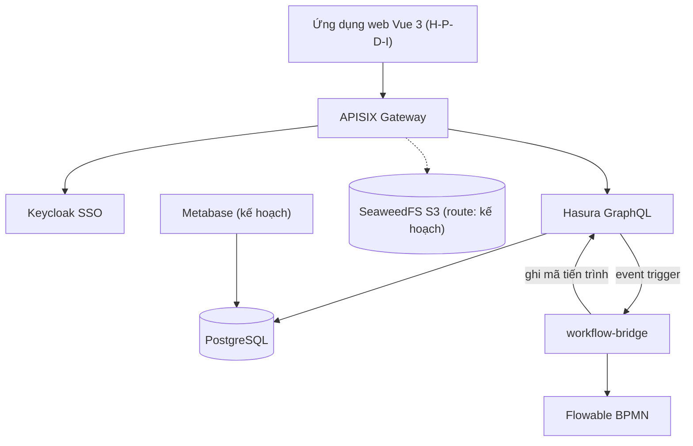

<!--
SPDX-FileCopyrightText: 2026 DX-Lab Project Hub contributors
SPDX-License-Identifier: Apache-2.0
-->

# Kiến trúc



Nguyên tắc: tầng lõi **headless** – chỉ cung cấp dịch vụ qua API; mọi giao diện nằm ở tầng ứng dụng.
## Bộ sinh ứng dụng

Một ứng dụng quy trình chỉ là dữ liệu: một dòng trong bảng `app` với cột `spec`:

```json
{
  "fields": [{ "key": "so_tien", "label": "Số tiền", "type": "number", "required": true }],
  "steps": [
    { "key": "truong_phong", "name": "Trưởng phòng duyệt", "role": "manager" },
    { "key": "giam_doc", "name": "Giám đốc duyệt", "role": "director",
      "when": { "field": "so_tien", "op": ">", "value": 5000000 } },
    { "key": "chi_tien", "name": "Kế toán chi tiền", "role": "accountant", "type": "task" }
  ]
}
```

Khi `spec` được tạo hoặc sửa, `workflow-bridge` kiểm tra rồi biên dịch (`services/workflow-bridge/compile.js`):

| Từ spec | Sinh ra | Ở đâu |
|---|---|---|
| `steps`, `when` | Quy trình BPMN `app_<key>` (user task theo vai trò, cổng rẽ nhánh, nhánh từ chối) | Flowable |
| `fields` | View phẳng `bi.app_<key>` đã ép kiểu | PostgreSQL |
| `fields` | Kiểm tra kiểu / bắt buộc khi gửi hồ sơ (trigger `submission_check`) | PostgreSQL |
| `role` của bước đang chờ | Ai được thấy và hành động trên hồ sơ (`waiting_role`) | Hasura |

Mọi định danh trong spec bị ép theo mẫu `^[a-z][a-z0-9_]{1,30}$` trước khi chèn vào BPMN hay SQL; có kiểm thử cho các trường hợp chèn mã.

Trợ lý AI (`ai.js`, Hasura action `generateApp`, chỉ role `manager`) chỉ tạo ra `spec` đề xuất. Kết quả đi qua cùng bộ kiểm tra, được tự sửa một lần nếu sai, và không bao giờ tự xuất bản.

## Quy trình là mã nguồn mở

Cách dự án nguồn mở quản lý mã được áp dụng cho quy trình của tổ chức:

| Trong dự án nguồn mở | Trong DX-Lab | Ở đâu |
|---|---|---|
| Commit / release | Phiên bản quy trình bất biến, có ghi chú | bảng `app_version` |
| Pull request | Đề xuất thay đổi | bảng `app_change` |
| CI kiểm tra PR | Kiểm tra hợp lệ + chạy thử trên hồ sơ cũ (`simulate` trong `compile.js`), ghi vào `app_change.checks` | `workflow-bridge` |
| Review bắt buộc | Người duyệt phải khác người đề xuất; thiếu kết quả kiểm tra thì không chấp nhận được | quyền Hasura + trigger `app_change_decide` |
| Issue | Góp ý / báo lỗi quy trình | bảng `app_issue` |
| Fork | Lấy quy trình từ `library/` làm điểm xuất phát; xuất JSON để đóng góp lại | Hasura action `library` |

Chấp nhận một đề xuất chạy trong một giao dịch cơ sở dữ liệu: cập nhật `app`, thêm `app_version`, rồi `workflow-bridge` triển khai định nghĩa mới lên Flowable. Hồ sơ đang chạy tiếp tục theo phiên bản cũ; mỗi hồ sơ lưu `app_version` lúc gửi nên luôn hiển thị đúng sơ đồ của nó.

## Luồng xử lý một hồ sơ

1. Người dùng tạo `submission` qua GraphQL (Hasura tự gán `submitter_id` từ token; trigger DB kiểm dữ liệu theo spec).
2. Hasura event trigger gọi `workflow-bridge`, dịch vụ này khởi tạo tiến trình `app_<key>` trên Flowable với `businessKey` = mã hồ sơ, rồi ghi bước đang chờ (`current_step`, `waiting_role`) vào hồ sơ.
3. Người có đúng vai trò đang chờ thêm một dòng `submission_event` (`approve` / `reject` / `done`); Hasura chặn mọi người khác và mọi hồ sơ đã kết thúc.
4. Event trigger khiến `workflow-bridge` hoàn tất đúng user task đó trên Flowable, rồi đồng bộ lại bước kế tiếp hoặc kết quả cuối.

Phân quyền chỉ đặt ở một nơi (Hasura); Flowable là nguồn sự thật của quy trình; `submission_event` là nhật ký chỉ-thêm. Sự kiện được Hasura gửi lại khi lỗi nên các bước ở `workflow-bridge` đều chạy lại được an toàn.

## Xác thực

Keycloak cấp JWT; APISIX kiểm tra chữ ký tại biên (JWKS), Hasura kiểm tra lại và lấy role từ `realm_access.roles`, mã người dùng từ `sub`.
