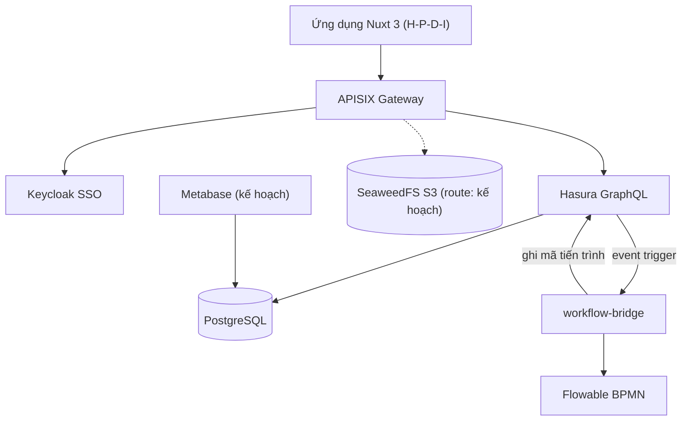

<!--
SPDX-FileCopyrightText: 2026 DX-Lab Project Hub contributors
SPDX-License-Identifier: Apache-2.0
-->

# Kiến trúc

Nguyên tắc: tầng lõi **headless** – chỉ cung cấp dịch vụ qua API; mọi giao diện nằm ở tầng ứng dụng.
## Luồng phê duyệt yêu cầu

1. Nhân viên tạo `request` qua GraphQL (Hasura tự gán `requester_id` từ token).
2. Hasura event trigger gọi `workflow-bridge`, dịch vụ này khởi tạo tiến trình `requestApproval` trên Flowable với `businessKey` = mã yêu cầu.
3. Quản lý đổi `status` thành `approved`/`rejected` qua GraphQL; chỉ role `manager` có quyền này và chỉ với yêu cầu đang `pending`.
4. Event trigger thứ hai khiến `workflow-bridge` hoàn tất bước "xem xét" trên Flowable; tiến trình kết thúc ở nút tương ứng.

Phân quyền chỉ đặt ở một nơi (Hasura); Flowable giữ trạng thái và lịch sử quy trình. Sự kiện được Hasura gửi lại khi lỗi nên các bước ở `workflow-bridge` đều chạy lại được an toàn.

## Xác thực

Keycloak cấp JWT; APISIX kiểm tra chữ ký tại biên (JWKS), Hasura kiểm tra lại và lấy role từ `realm_access.roles`, mã người dùng từ `sub`.
