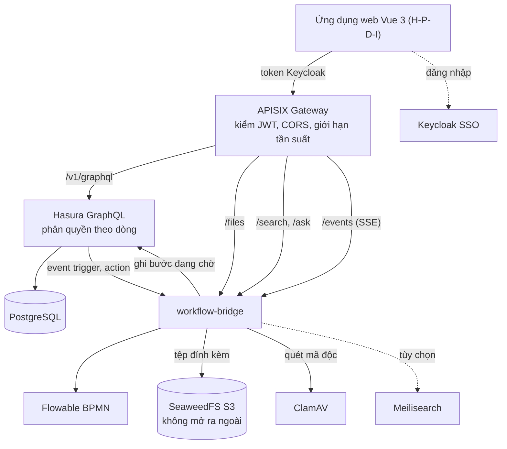

<!--
SPDX-FileCopyrightText: 2026 DX-Lab Project Hub contributors
SPDX-License-Identifier: Apache-2.0
-->

# Kiến trúc



Nguyên tắc: tầng lõi **headless** – chỉ cung cấp dịch vụ qua API; mọi giao diện nằm ở tầng ứng dụng.

## Các không gian trong ứng dụng

| Không gian | Màn hình | Dữ liệu |
|---|---|---|
| [H] Con người | Bàn làm việc, Bảng công việc (Kanban), Lịch, Tài liệu, Cá nhân và thông báo | `submission`, `attachment`, `submission_event` |
| [P] Quy trình | Gửi hồ sơ, trang hồ sơ (ô ký, nhật ký), Quy trình (phiên bản, đề xuất, góp ý), Soạn quy trình | `app`, `app_version`, `app_change`, `app_issue`, `submission_event` |
| [D] Dữ liệu | Số liệu: thời gian xử lý, điểm nghẽn, trạng thái, theo loại hồ sơ | tính từ `submission` và `submission_event` (`web/src/metrics.js`, có kiểm thử) |
| [I] Trí tuệ | Hỏi đáp tài liệu có dẫn nguồn, Trợ lý AI thử việc, trợ lý phác thảo trong Soạn quy trình | `/ask`, `/search`, `step_autonomy`, `ai_opinion`, Hasura action `generateApp` |

Ứng dụng web có nhãn H/P/D/I cạnh từng mục điều hướng và hai ngôn ngữ vi/en (`web/src/i18n.js`).

## Tệp đính kèm

**Kho lạnh và phả hệ.** Mỗi ngày (hoặc khi giám đốc gọi `POST /archive`), hồ sơ đã kết thúc quá `ARCHIVE_AFTER_DAYS` (mặc định 90) được xuất kèm nhật ký ra một tệp JSONL trong bucket `dxlab-cold`. Bảng `cold_archive` là sổ cái băm nối chuỗi (mỗi dòng ghi mã băm tệp và mã băm dòng trước) và cùng `cold_item` đều chỉ thêm, không sửa/xóa được ở tầng CSDL; `GET /archive/verify` kiểm lại chuỗi và từng tệp. `GET /lineage` trả đồ thị phả hệ: view báo cáo `bi.app_*` đọc từ bảng nào lấy tự động từ danh mục PostgreSQL, cộng các luồng xuống kho lạnh và số liệu. `POST /ingest?app=<mã>` nạp hàng loạt (tối đa 500 dòng CSV hoặc JSON), từng dòng đi bằng token của người nạp nên mọi rào chắn vẫn nguyên. Dữ liệu kho lạnh nằm trong volume `s3data` nên được `scripts/backup.sh` sao lưu.

**Cảm biến IT/OT.** Giám đốc đăng ký cảm biến (`POST /sensors`: ngưỡng, chiều vượt, ứng dụng sửa chữa) và nhận token thiết bị một lần; CSDL chỉ giữ mã băm. Thiết bị gửi `POST /telemetry/<mã>` kèm `x-sensor-token` (cổng API chỉ giới hạn tần suất, vì thiết bị không có tài khoản Keycloak; bridge kiểm token). Số đo ghi vào `sensor_reading` (bất biến). Vượt ngưỡng thì bridge mở một hồ sơ trong ứng dụng sửa chữa (mẫu `library/iot/sua_chua.json`) nhân danh chủ cảm biến; hồ sơ đó đi qua Flowable như mọi hồ sơ khác. Còn hồ sơ đang chạy thì không mở thêm. `GET /sensors` cho trưởng phòng và giám đốc thấy trạng thái hiện tại (bản sao số) và cập nhật theo thời gian thực qua kênh SSE.

**Thời gian thực.** `GET /events` là kênh Server-Sent Events qua cổng API (cần token). Mỗi khi `workflow-bridge` xử lý xong một sự kiện của Hasura (hồ sơ mới, có người ký, ứng dụng xuất bản) hoặc nhận tệp, nó đẩy một nhịp rỗng tới mọi trình duyệt đang mở. Trình duyệt nhận nhịp rồi tự tải lại bằng GraphQL **với token của chính người dùng**, nên kênh không mang dữ liệu và không thể làm lộ gì. Kênh đứt thì giao diện quay về hỏi định kỳ 3 giây; kênh sống thì chỉ hỏi bù 30 giây một lần (`web/src/live.js`, dùng chung cho mọi màn hình). Giới hạn: danh sách kết nối giữ trong bộ nhớ của một tiến trình bridge.

Nội dung tệp nằm trong kho S3 (SeaweedFS); bảng `attachment` giữ tên, kích thước và khóa đối tượng. Tệp đi qua `POST /files` và `GET /files/<id>` của cổng API:

1. Cổng API kiểm chữ ký token (JWKS của Keycloak).
2. `workflow-bridge` gọi Hasura **bằng chính token của người dùng**; quyền xem/đính kèm do cùng bộ luật phân quyền của hồ sơ quyết định, nên không có hai nơi định nghĩa "ai được thấy tệp".
3. Dòng dữ liệu được ghi trước, rồi mới ghi tệp vào S3; nếu ghi S3 lỗi thì dòng bị xóa để không có bản ghi trỏ vào tệp không tồn tại.
4. Tải về luôn là `attachment` kèm `nosniff`: tệp do người dùng gửi không bao giờ được trình duyệt mở như trang web.

Mọi tệp được quét bằng ClamAV (chạy container riêng) **trước khi** ghi vào cơ sở dữ liệu hay kho S3; tệp nhiễm bị từ chối (422), trạm quét lỗi thì từ chối luôn (503) thay vì cho qua. Mỗi tệp tối đa 10 MB.

## Nhiều tổ chức

Cách ly theo tổ chức nằm ở dữ liệu, không ở giao diện. Keycloak đặt thuộc tính `org_id` của người dùng vào token; Hasura đọc thành `x-hasura-org-id` (thiếu thì `default`) và thêm điều kiện tổ chức vào mọi quyền đọc, ghi của mọi vai trò. `app` và `submission` mang cột `org_id` (hồ sơ lấy `org_id` từ quy trình nhận nó bằng trigger, người gửi không chọn được); các bảng còn lại cách ly qua quan hệ tới `app` hoặc `submission`. Các đường đi bằng quyền người dùng (tệp, tìm kiếm, nạp hàng loạt) kế thừa cách ly này. Các đường dùng quyền quản trị tự lọc theo tổ chức lấy từ token: kho lạnh (mỗi tổ chức một chuỗi sổ cái, một thư mục trong kho) và cảm biến. Giới hạn: mã ứng dụng vẫn duy nhất toàn hệ thống. Chi tiết kiểm thử: [KIEM_THU.md](KIEM_THU.md).

## Trợ lý AI thử việc

Bảng `step_autonomy` giữ nấc tự chủ (1 đến 4) của từng bước duyệt; bảng `ai_opinion` giữ ý kiến của AI và quyết định thật của người để đo độ khớp.

1. Khi một hồ sơ vào bước duyệt có nấc ≥ 2, `workflow-bridge` (ở nền, không làm chậm luồng của người) gửi cho AI hồ sơ, tên bước và tối đa 6 quyết định gần đây của người ở đúng bước đó; AI trả `{decision, reason}`. Câu trả lời sai khuôn bị bỏ, không đoán. Dịch vụ AI giới hạn tần suất thì thử lại vài lần rồi thôi.
2. Người quyết định xong thì trigger `ai_opinion_settle` ghi `human_action` và `matched`.
3. Nấc 2: ý kiến chỉ giám đốc xem được. Nấc 3 trở lên: người duyệt thấy gợi ý cho hồ sơ đang chờ chính họ. Nấc 4: nếu ý kiến là duyệt, bridge ghi sự kiện duyệt với người thực hiện "Trợ lý AI"; nếu là từ chối, không làm gì, hồ sơ vẫn chờ người.
4. Trigger `autonomy_guard` chặn nâng nấc thiếu bằng chứng (kể cả khi gọi thẳng vào cơ sở dữ liệu): chỉ vai trò giám đốc, từng nấc một, và từ nấc 2 lên cần ≥ 10 ý kiến đã có người quyết ở nấc hiện tại với ≥ 90% khớp, không tính dữ liệu mẫu hay lần AI tự duyệt.

AI lỗi hoặc chưa cấu hình thì mọi thứ chạy như nấc 1.

## Tìm kiếm và hỏi đáp có kiểm quyền

Thành phần tùy chọn (profile `search`). `workflow-bridge` nạp nội dung hồ sơ và tệp văn bản vào Meilisearch. Khi người dùng hỏi (`POST /ask`) hoặc tìm (`POST /search`): chỉ mục trả các đoạn khớp, rồi **Hasura kiểm lại từng kết quả bằng chính token của người hỏi**, nên quyền xem chỉ có một nơi định nghĩa. AI chỉ nhận các đoạn đã qua kiểm quyền và chỉ được trả lời từ đó, ghi số nguồn. Chi tiết và giới hạn: [TRI_TUE.md](TRI_TUE.md).

## Bảo mật khi triển khai

- Chỉ ba cổng mở ra máy chủ: ứng dụng web, cổng API, trang đăng nhập Keycloak. Cơ sở dữ liệu, Hasura, Flowable, kho S3, ClamAV, Meilisearch chỉ nằm trong mạng nội bộ.
- Console Hasura tắt; Keycloak chạy chế độ production (`start`), chống dò mật khẩu, **MFA (OTP) bắt buộc cho trưởng phòng và giám đốc**.
- Ứng dụng web chỉ đăng nhập bằng luồng chuyển hướng có PKCE. Đăng nhập bằng mật khẩu trực tiếp chỉ bật cho client `dxlab-cli` (kiểm thử và nạp dữ liệu mẫu).
- Tiêu đề bảo mật cho web (CSP, chống nhúng khung, nosniff); nhật ký ký duyệt bất biến ở tầng cơ sở dữ liệu; mọi tệp được quét mã độc.
- TLS tại biên bằng Caddy (profile `tls`), giám sát bằng Prometheus (profile `monitoring`), sao lưu và khôi phục bằng `scripts/backup.sh`, `scripts/restore.sh`: xem [VAN_HANH.md](VAN_HANH.md).
- Chưa có: két bí mật (bí mật hiện nằm trong `.env`), WAF, ẩn thông tin định danh (PII), sao lưu tự động theo lịch. Trước khi đưa lên Internet phải đổi mọi mật khẩu mẫu và bật TLS.

## Bộ sinh ứng dụng

Một ứng dụng quy trình chỉ là dữ liệu: một dòng trong bảng `app` với cột `spec`:

```json
{
  "fields": [{ "key": "so_tien", "label": "Số tiền", "type": "number", "required": true }],
  "steps": [
    { "key": "truong_phong", "name": "Trưởng phòng duyệt", "role": "manager" },
    { "key": "giam_doc", "name": "Giám đốc duyệt", "role": "director",
      "when": { "field": "so_tien", "op": ">", "value": 5000000 } },
    { "key": "chi_tien", "name": "Kế toán chi tiền", "role": "accountant", "type": "task" }
  ]
}
```

Khi `spec` được tạo hoặc sửa, `workflow-bridge` kiểm tra rồi biên dịch (`services/workflow-bridge/compile.js`):

| Từ spec | Sinh ra | Ở đâu |
|---|---|---|
| `steps`, `when` | Quy trình BPMN `app_<key>` (user task theo vai trò, cổng rẽ nhánh, nhánh từ chối) | Flowable |
| `fields` | View phẳng `bi.app_<key>` đã ép kiểu | PostgreSQL |
| `fields` | Kiểm tra kiểu / bắt buộc khi gửi hồ sơ (trigger `submission_check`) | PostgreSQL |
| `role` của bước đang chờ | Ai được thấy và hành động trên hồ sơ (`waiting_role`) | Hasura |

Mọi định danh trong spec bị ép theo mẫu `^[a-z][a-z0-9_]{1,30}$` trước khi chèn vào BPMN hay SQL; có kiểm thử cho các trường hợp chèn mã.

Trợ lý AI (`ai.js`, Hasura action `generateApp`, chỉ role `manager`) chỉ tạo ra `spec` đề xuất. Kết quả đi qua cùng bộ kiểm tra, được tự sửa một lần nếu sai, và không bao giờ tự xuất bản.

## Quy trình là mã nguồn mở

Cách dự án nguồn mở quản lý mã được áp dụng cho quy trình của tổ chức:

| Trong dự án nguồn mở | Trong DX-Lab | Ở đâu |
|---|---|---|
| Commit / release | Phiên bản quy trình bất biến, có ghi chú | bảng `app_version` |
| Pull request | Đề xuất thay đổi | bảng `app_change` |
| CI kiểm tra PR | Kiểm tra hợp lệ + chạy thử trên hồ sơ cũ (`simulate` trong `compile.js`), ghi vào `app_change.checks` | `workflow-bridge` |
| Review bắt buộc | Người duyệt phải khác người đề xuất; thiếu kết quả kiểm tra thì không chấp nhận được | quyền Hasura + trigger `app_change_decide` |
| Issue | Góp ý / báo lỗi quy trình | bảng `app_issue` |
| Fork | Lấy quy trình từ `library/` làm điểm xuất phát; xuất JSON để đóng góp lại | Hasura action `library` |

Chấp nhận một đề xuất chạy trong một giao dịch cơ sở dữ liệu: cập nhật `app`, thêm `app_version`, rồi `workflow-bridge` triển khai định nghĩa mới lên Flowable. Hồ sơ đang chạy tiếp tục theo phiên bản cũ; mỗi hồ sơ lưu `app_version` lúc gửi nên luôn hiển thị đúng sơ đồ của nó.

## Luồng xử lý một hồ sơ

1. Người dùng tạo `submission` qua GraphQL (Hasura tự gán `submitter_id` từ token; trigger DB kiểm dữ liệu theo spec).
2. Hasura event trigger gọi `workflow-bridge`, dịch vụ này khởi tạo tiến trình `app_<key>` trên Flowable với `businessKey` = mã hồ sơ, rồi ghi bước đang chờ (`current_step`, `waiting_role`) vào hồ sơ.
3. Người có đúng vai trò đang chờ thêm một dòng `submission_event` (`approve` / `reject` / `done`); Hasura chặn mọi người khác và mọi hồ sơ đã kết thúc.
4. Event trigger khiến `workflow-bridge` hoàn tất đúng user task đó trên Flowable, rồi đồng bộ lại bước kế tiếp hoặc kết quả cuối.

Phân quyền chỉ đặt ở một nơi (Hasura); Flowable là nguồn sự thật của quy trình; `submission_event` là nhật ký chỉ-thêm. Sự kiện được Hasura gửi lại khi lỗi nên các bước ở `workflow-bridge` đều chạy lại được an toàn.

## Xác thực

Keycloak cấp JWT; APISIX kiểm tra chữ ký tại biên (JWKS), Hasura kiểm tra lại và lấy role từ `realm_access.roles`, mã người dùng từ `sub`.
